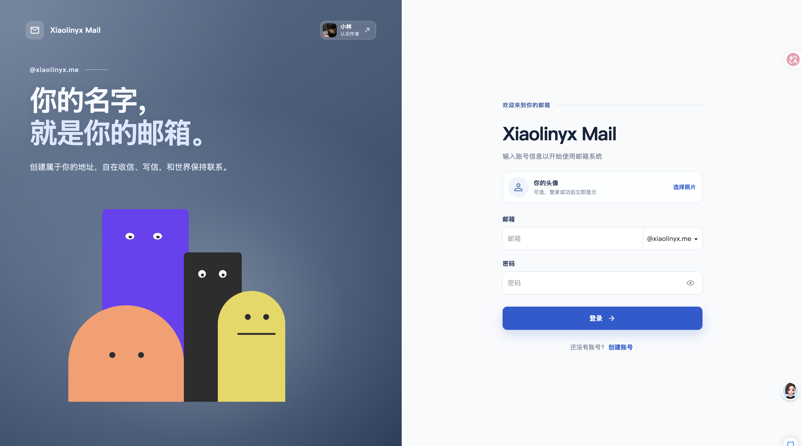
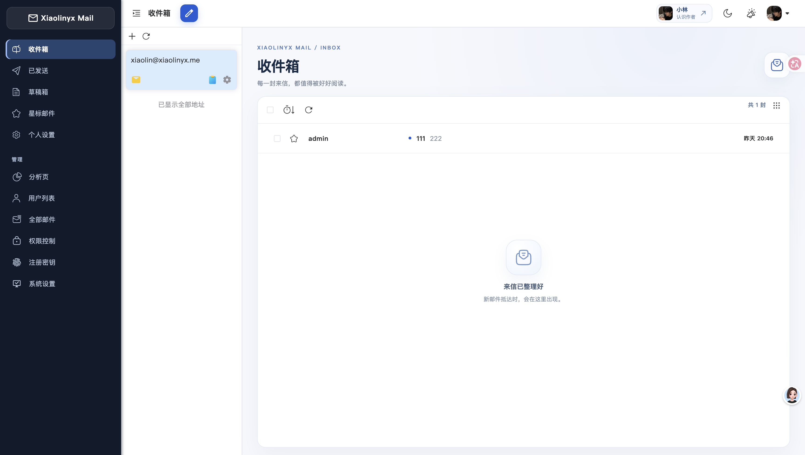
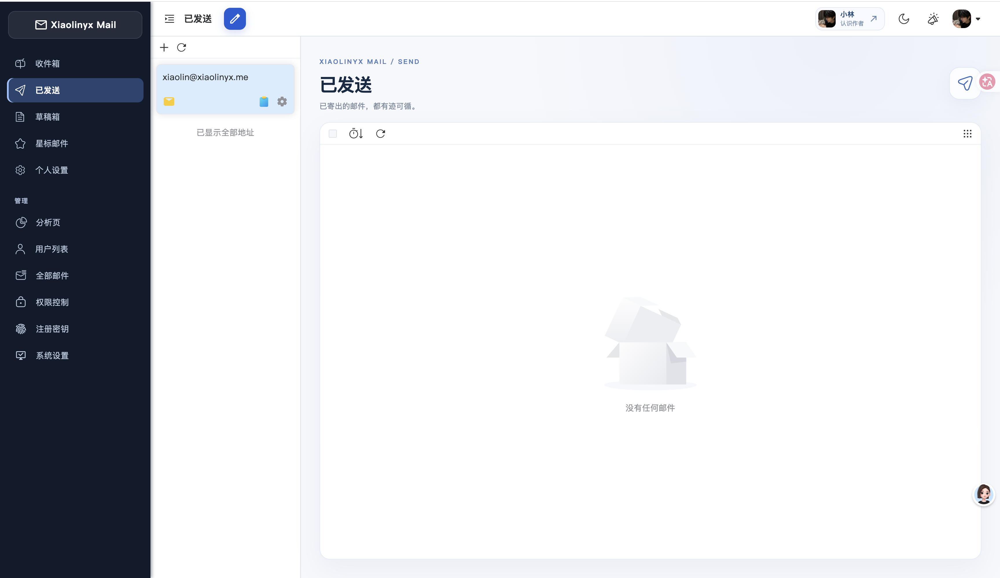
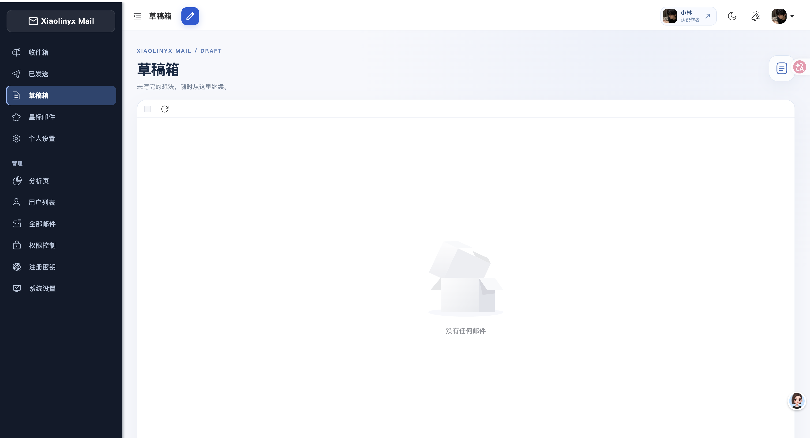
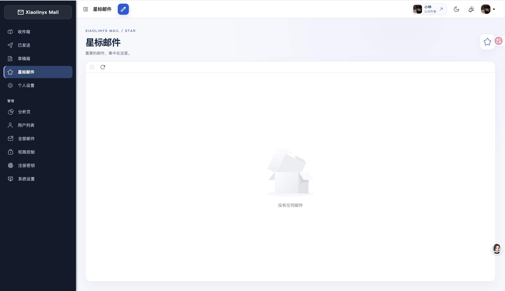
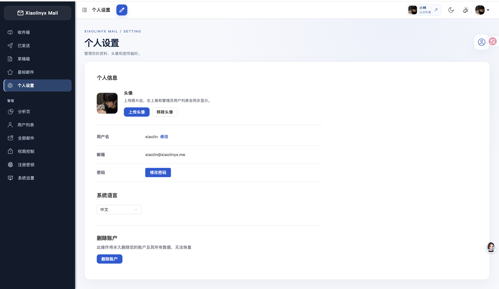

<p align="center">
    
    <h1 align="center">Xiaolinyx Mail</h1>
    <p align="center">你的名字，就是你的邮箱。基于 Cloud Mail 打造的个人邮箱服务。</p>
    <p align="center">
        简体中文 | <a href="/README-en.md" style="margin-left: 5px">English </a>
    </p>
    <p align="center">
        <a href="https://github.com/maillab/cloud-mail/tree/main?tab=MIT-1-ov-file" target="_blank" >
            
        </a>    
        <a href="https://github.com/maillab/cloud-mail/releases" target="_blank" >
            
        </a>  
        <a href="https://github.com/maillab/cloud-mail/issues" >
            
        </a>  
        <a href="https://github.com/maillab/cloud-mail/stargazers" target="_blank">
            
        </a>  
        <a href="https://github.com/maillab/cloud-mail/forks" target="_blank" >
            
        </a>
    </p>
    <p align="center">
        <a href="https://trendshift.io/repositories/20459" target="_blank" >
            
        </a>
    </p>
</p>
## Xiaolinyx Mail

**[打开邮箱](https://mail.xiaolinyx.me)** · [观看界面演示视频](#操作演示) · [查看原项目 Cloud Mail](https://github.com/maillab/cloud-mail)

一个能用自己的名字创建邮箱地址的地方。你可以在这里注册 `@xiaolinyx.me` 邮箱，收发邮件、保存草稿、标记重要来信，并在个人设置里上传头像。界面适配桌面和手机，登录页的小角色会随着输入和鼠标移动做出回应。

### 操作演示

https://github.com/user-attachments/assets/666d8a18-e22c-417c-b3e6-d9c83acc12bf

点击播放器即可在线预览；也可以[下载原画质录屏](doc/demo/xiaolinyx/overview.mov)。

### 看看现在的界面



| 收件箱：集中查看来信 | 已发送：回顾寄出的邮件 |
| --- | --- |
|  |  |
| 草稿箱：接着写未完成的邮件 | 星标邮件：把重要内容留在手边 |
|  |  |
| 个人设置：上传头像、管理账号 | 关于作者：找到公开主页和联系方式 |
|  |  |

### 这版做了什么

- **有自己的邮箱地址**：注册并使用 `@xiaolinyx.me` 邮箱，支持登录、收件、写信和发送。
- **更顺手的邮件整理**：收件箱、已发送、草稿箱和星标邮件各有清晰入口。
- **更有个人感的界面**：注册时可选择头像，登录后可在个人设置中更新；头像会同步显示在账号入口。登录页加入了会跟随交互的小角色。
- **联系作者**：在登录页或邮箱顶部打开“关于作者”，查看 GitHub、X / Twitter、微信公众号、微信名片和 AI 交流群。
- **手机也能使用**：页面针对窄屏重新排布，常用操作在移动端同样可用。

> 本仓库基于开源项目 [Cloud Mail](https://github.com/maillab/cloud-mail) 继续开发。下面保留了原项目的介绍、截图和功能说明，方便了解基础能力与项目来源；具体可用功能以当前站点和部署配置为准。

## 项目简介

只需要一个域名，就可以创建多个不同的邮箱，类似各大邮箱平台，本项目支持署到 Cloudflare Workers ，降低服务器成本，搭建自己的邮箱服务

## 原项目展示

- [Cloud Mail 在线演示](https://skymail.ink)<br>
- [Cloud Mail 部署文档](https://doc.skymail.ink)<br>

|  |  |
|-----------------------|-----------------------|
|  |  |


## 功能介绍

- **💰 低成本使用**： 可部署到 Cloudflare Workers 降低服务器成本

- **💻 响应式设计**：响应式布局自动适配PC和大部分手机端浏览器

- **📧 邮件发送**：集成Resend发送邮件，支持群发，内嵌图片和附件发送，发送状态查看

- **🛡️ 管理员功能**：可以对用户，邮件进行管理，RABC权限控制对功能及使用资源限制

- **📦 附件收发**：支持收发附件，使用R2对象存储保存和下载文件

- **🔔 邮件推送**：接收邮件后可以转发到TG机器人或其他服务商邮箱

- **📡 开放API**：支持使用API批量生成用户，多条件查询邮件 

- **🔢 验证码识别**：使用Workers AI，自动识别邮件验证码 

- **📈 数据可视化**：使用ECharts对系统数据详情，用户邮件增长可视化显示

- **🎨 个性化设置**：可以自定义网站标题，登录背景，透明度

- **🤖 人机验证**：集成Turnstile人机验证，防止人机批量注册

- **📜 更多功能**：正在开发中...


## 技术栈

- **平台**：[Cloudflare Workers](https://developers.cloudflare.com/workers/)

- **Web框架**：[Hono](https://hono.dev/)

- **ORM：**[Drizzle](https://orm.drizzle.team/)

- **前端框架**：[Vue3](https://vuejs.org/) 

- **UI框架**：[Element Plus](https://element-plus.org/) 

- **邮件推送：** [Resend](https://resend.com/)

- **缓存**：[Cloudflare KV](https://developers.cloudflare.com/kv/)

- **数据库**：[Cloudflare D1](https://developers.cloudflare.com/d1/)

- **文件存储**：[Cloudflare R2](https://developers.cloudflare.com/r2/)

## 目录结构

```
cloud-mail
├── mail-worker				    # worker后端项目
│   ├── src                  
│   │   ├── api	 			    # api接口层			
│   │   ├── const  			    # 项目常量
│   │   ├── dao                 # 数据访问层
│   │   ├── email			    # 邮件处理接收
│   │   ├── entity			    # 数据库实体
│   │   ├── error			    # 自定义异常
│   │   ├── hono			    # web框架配置、拦截器、全局异常等
│   │   ├── i18n			    # 语言国际化
│   │   ├── init			    # 数据库缓存初始化
│   │   ├── model			    # 响应体数据封装
│   │   ├── security			# 身份权限认证
│   │   ├── service			    # 业务服务层
│   │   ├── template			# 消息模板
│   │   ├── utils			    # 工具类
│   │   └── index.js			# 入口文件
│   ├── pageckge.json			# 项目依赖
│   └── wrangler.toml			# 项目配置
│
├── mail-vue				    # vue前端项目
│   ├── src
│   │   ├── axios 			    # axios配置
│   │   ├── components			# 自定义组件
│   │   ├── echarts			    # echarts组件导入
│   │   ├── i18n			    # 语言国际化
│   │   ├── init			    # 入站初始化
│   │   ├── layout			    # 主体布局组件
│   │   ├── perm			    # 权限认证
│   │   ├── request			    # api接口
│   │   ├── router			    # 路由配置
│   │   ├── store			    # 全局状态管理
│   │   ├── utils			    # 工具类
│   │   ├── views			    # 页面组件
│   │   ├── app.vue			    # 入口组件
│   │   ├── main.js			    # 入口js
│   │   └── style.css			# 全局css
│   ├── package.json			# 项目依赖
└── └── env.release				# 项目配置
```

## 赞助

<a href="https://doc.skymail.ink/support.html" >

</a>

## 许可证

本项目采用 [MIT](LICENSE) 许可证	


## 交流

[Telegram](https://t.me/cloud_mail_tg)

